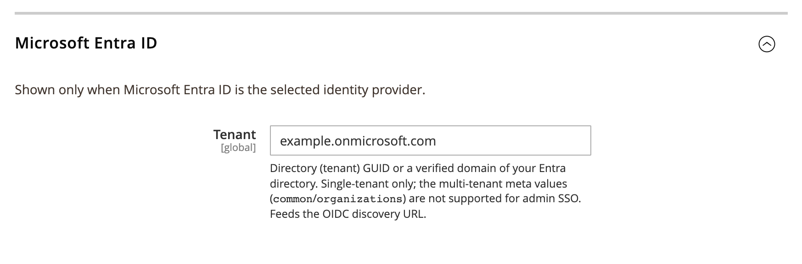

# DmLab_AdminSsoAzure

> Microsoft Entra ID (Azure AD) login for the Magento 2 admin panel.

[](https://github.com/dmlab-work/module-admin-sso-azure/actions/workflows/ci.yml) [](https://codecov.io/gh/dmlab-work/module-admin-sso-azure) [](https://packagist.org/packages/dmlab/module-admin-sso-azure) [](https://packagist.org/packages/dmlab/module-admin-sso-azure) [](https://packagist.org/packages/dmlab/module-admin-sso-azure) [](LICENSE) 

Your team signs in to the Magento admin with their Microsoft work account — a "Sign in with Microsoft" button on
the admin login page. Admin accounts are created on first sign-in and get their role from Entra ID groups, so there
are no separate Magento passwords to manage. Free, no user cap.



## Install

```bash
composer require dmlab/module-admin-sso-azure  # also installs Admin SSO and the SSO engine
bin/magento module:enable DmLab_SsoCore DmLab_AdminSso DmLab_AdminSsoAzure
bin/magento setup:upgrade
```

## Register the Entra app

In the [Azure portal](https://portal.azure.com) → **Microsoft Entra ID → App registrations → New registration**:

1. **Supported account types**: **Accounts in this organizational directory only** (single tenant).
   Multi-tenant admin login is not supported.
2. **Redirect URI**: platform **Web**, value `https://<admin-host>/<admin-path>/adminsso/sso/callback`
   (`<admin-path>` is the backend frontName, default `admin`). It must exactly match the admin URL used at runtime.
3. Register, then copy the **Application (client) ID** and the **Directory (tenant) ID**.
4. **Certificates & secrets → New client secret**: copy the secret **value**.
5. **Groups claim** (needed for group → role mapping): **Token configuration → Add groups claim**, emitted on the
   **ID** token. Entra sends group **object IDs (GUIDs)**, not names — use those GUIDs as keys in the Admin SSO
   group → role map. Without it, everyone gets the Admin SSO default role (sign-in is refused if none is set).
6. **Email verification**: **Token configuration → Add optional claim → ID → `xms_edov`**. Entra's `email` is
   editable in the tenant, so it counts as verified only when `xms_edov` is true. Without this claim, signing in
   as an existing admin that is not linked yet is refused.
7. **Restrict sign-in**: **Enterprise applications → (your app) → Properties → Assignment required? = Yes**, then
   assign users/groups under **Users and groups**. Otherwise any user in the directory whose groups map to a role,
   or who gets the default role, can sign in.

### Configuration

Admin → Stores → Configuration → **DMLab → Admin SSO**.

| Field | Path | Value |
|---|---|---|
| Enable Admin SSO | `general/enabled` | Yes |
| Identity Provider | `general/active_provider` | Microsoft Entra ID |
| Client ID / Client Secret | `general/client_id`, `general/client_secret` | from the Entra app (secret **value**) |
| Tenant | `azure/tenant` | Directory (tenant) GUID or a verified domain of your directory; shown when Entra is selected |

Paths are under `dmlab_admin_sso/`. The tenant must be a single directory: `common` / `organizations` /
`consumers` are rejected. The directory GUID is preferred; a verified domain (e.g. `contoso.com`) works too.
Group → role mapping and enforce-SSO/break-glass are set in [admin-sso](https://github.com/dmlab-work/module-admin-sso).

### Users without an email

If a user has no `mail` attribute (no `email` claim), `preferred_username`, then `upn`, is used as the email when
it is a valid address. Such a sign-in counts as unverified: it can create a new admin, but if an admin with that
email already exists, the sign-in is refused.

### Groups overage

When a user belongs to more than ~200 groups, Entra leaves the groups out of the token. The groups are then
incomplete, so the sign-in is **refused** with a message instead of falling back to the default role. Limit the
groups in the token: under Token configuration emit **Groups assigned to the application** (and assign the role
groups to the enterprise app), or use group filtering.

## Requirements

- Magento 2.4.7+ · PHP 8.2–8.5
- A single-tenant Microsoft Entra ID directory where you can register an app
- An HTTPS admin URL (Entra web redirect URIs must be HTTPS)
- Outbound HTTPS from Magento to `login.microsoftonline.com`
- Admin SSO and the SSO engine (`dmlab/module-admin-sso`, `dmlab/module-sso-core`) — installed automatically

Pairs with [admin-scim-azure](https://github.com/dmlab-work/module-admin-scim-azure) — Entra pushes admin user
create/update/deactivate to Magento · built on [admin-sso](https://github.com/dmlab-work/module-admin-sso).

## Architecture

This module is the Microsoft Entra ID provider plugin for `admin-sso`. `Model/EntraPreset.php` supplies the
discovery URL built from the tenant (`https://login.microsoftonline.com/<tenant>/v2.0/.well-known/openid-configuration`),
scopes `openid profile email`, the `groups` claim and the login-button label and logo; `etc/di.xml` registers it
into admin-sso's `PresetRegistry`. The preset also:

- treats `email` as verified only when `xms_edov` is true;
- relaxes the discovery issuer check for verified-domain tenants (their discovery document advertises the
  tenant-GUID issuer); the token `iss` is still validated.

Two before-plugins on `sso-core`'s `IdentityFactory::create`, active for the Entra preset only:
`Plugin/EntraEmailFallback.php` (missing `email` → `preferred_username` / `upn`, unverified) and
`Plugin/EntraGroupsOverage.php` (implicit-flow `hasgroups` → incomplete groups, like the `_claim_names` overage).
The OIDC protocol lives in `sso-core`; admin users, roles and the login flow live in `admin-sso`.

## License

[OSL-3.0](LICENSE) © DMLab. Commercial licensing and support: <https://dmlab.work>.
